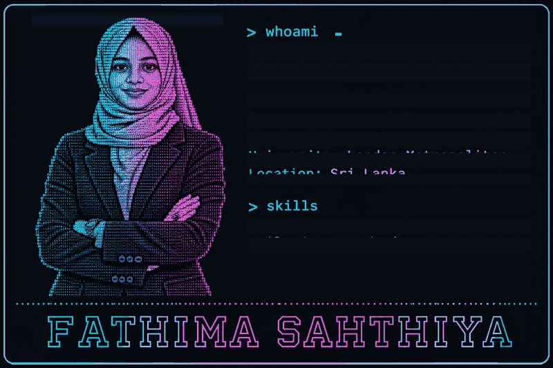

  

<h1 align="center">Hi 👋, I'm Fathima Sahthiya</h1>

  

Building practical digital solutions through code, design and an understanding of business needs.

---

## About me

I'm a **Software Engineering graduate from London Metropolitan University**, based in **Sri Lanka**. I build websites, web applications and mobile applications, with an interest in connecting technology to practical business needs.

- 🎓 BEng in Software Engineering
- 🤝 Experience in project coordination, stakeholder communication and Agile/Scrum
- 📊 Interested in business analysis, SQL, database design and data modeling
- 🌱 Continuously developing my technical and analytical skills

## Technology stack

### Web development

     

### Mobile development

**React Native** · Mobile application development

### Programming languages

   

### Tools and collaboration

   

**Jira · Trello · MS Project · Agile/Scrum · SDLC · Project documentation**

### Databases

**SQL · Database design · Data modeling**

## Selected projects

### 🏥 Hospital Website
Responsive website with service listings, doctor information and contact forms.

### 🏎️ Car Racing Event Management System
Java application for participant registration, eliminations and race results.

### 🌿 Crop Diagnostic Mobile Application
React Native application supporting crop diagnosis and recommendations.

---

## Let's connect

I'm happy to connect with people working in software development, mobile applications and business analysis.

[Connect on LinkedIn →](https://www.linkedin.com/in/mohamed-roomy-fathima-sahthiya-11643632a/)

<!-- Technology logos: Devicon (MIT), https://github.com/devicons/devicon. Brand marks belong to their respective owners. -->
