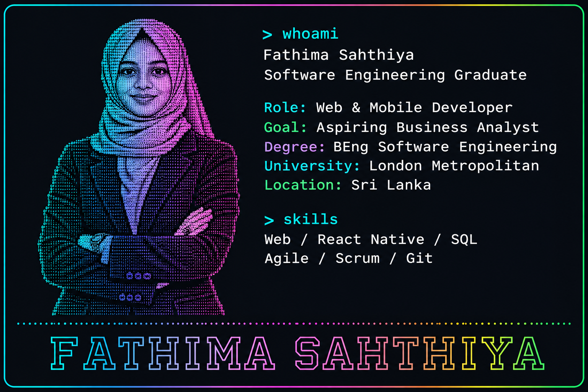

  

<h1 align="center">Hi 👋, I'm Fathima Sahthiya</h1>

  Software Engineering Graduate • Web Designer & Developer 
  Mobile App Developer • Aspiring Business Analyst

  <a href="https://www.linkedin.com/in/mohamed-roomy-fathima-sahthiya-11643632a/">
    Connect with me on LinkedIn
  </a>

---

### 👩‍💻 About Me

- 🎓 BEng in Software Engineering — London Metropolitan University
- 🌍 Based in Sri Lanka
- 💻 I build websites, web applications and mobile applications.
- 🤝 Experienced in project coordination, stakeholder communication and Agile/Scrum.
- 📊 Interested in business analysis, SQL and solving practical business problems.
- 🌱 Continuously developing my technical and analytical skills.

### 🛠️ Skills & Technologies

| Area | Skills |
|------|--------|
| Web Development | HTML, CSS, JavaScript, PHP, Bootstrap, ASP.NET |
| Mobile Development | React Native |
| Programming | Java, Python, C#, C++ |
| Databases | SQL, Database Design, Data Modeling |
| Project Delivery | Agile/Scrum, SDLC, Project Documentation |
| Tools | Jira, Trello, MS Project, Git, GitHub |

### 🚀 Projects

- **Hospital Website** — Responsive website with service listings, doctor information and contact forms.
- **Car Racing Event Management System** — Java application for registration, eliminations and results.
- **Crop Diagnostic Mobile Application** — React Native application supporting crop diagnosis and recommendations.

### 🤝 Connect With Me

[LinkedIn](https://www.linkedin.com/in/mohamed-roomy-fathima-sahthiya-11643632a/)
